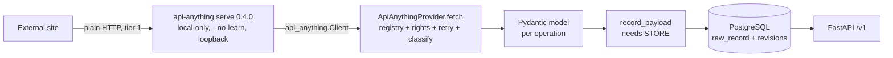

# API Anything integration

How Badminton Scout uses [API Anything](https://github.com/goodnight000/api-anything) (MIT): the runtime, the provider, the operation register, and the workflow for adding an operation. Policy is in ADR-0007.



## Runtime

| What | Value |
|---|---|
| Node package | `api-anything@0.4.0`, pinned in `tools/api-anything/package-lock.json` (integrity `sha512-k2JHW0…`), installed with `npm ci --ignore-scripts` |
| Python client | `api-anything 0.4.0` from git `goodnight000/api-anything@985ae8f` (not on PyPI), pinned in `backend/uv.lock` |
| Home | `.tools/api-anything-home` (git-ignored, mode 0700). Never `~/.api-anything` |
| Flags | `serve --host 127.0.0.1 --port 0 --no-learn`, writes off, `API_ANYTHING_LOCAL_ONLY=1`. The child's environment is blanked except `PATH`, `HOME`, `USER`, `LOGNAME`, `SHELL`, `TMPDIR`, `LANG`, `TZ` |
| Started by | `scout.ingest.api_anything.local_runtime()`, a context manager that stops the server on exit |

Claude Code MCP was **not** configured: `api-anything setup` edits user-level agent configuration, and that needs separate approval. `tools/api-anything/node_modules/.bin/api-anything mcp --print-config` shows what it would add, without changing anything.

## Commands

```sh
make api-anything-install   # npm ci of the pinned runtime
make api-anything-doctor    # node, binary, runtime health, every approved operation discoverable
make api-anything-test      # offline provider contract tests (also part of make check)
make api-anything-smoke     # LIVE: HN smoke + Tournament Software (BA), about 3 paced requests. Never in CI
```

## Approved operations (`scout.ingest.operations.OPERATIONS`)

| Name | Site/op | Source (grants) | Model | Validation evidence |
|---|---|---|---|---|
| `hacker_news.search` | `hacker-news/search` (Algolia HN search, bundled spec) | `hacker_news_smoke` (LOCAL_RESEARCH only) | `HackerNewsHit` | Live 2026-11-12: 30 items, tier 1, 685 ms, 1 attempt. Invalid `type` → class `input`, not retried. **Smoke test only. Never stored** |

| `tournamentsoftware_ba.matches_in_day` | `tournamentsoftware-ba/matchesInDay`: `GET https://ba.tournamentsoftware.com/tournament/{tournament}/Matches/MatchesInDay?date={YYYYMMDD}`, HTML recipe over `.match.match--list` | `tournamentsoftware_ba` (all uses, ADR-0008) | `TsMatchRow` | Learned 2026-11-12 with `add` from (Silver Cup 57b545bf…, 20261017) and (Qld Challenge BDC94107…, 20261031). Held-out Vic Graded 3 (325a6e18…). **438/438 fields** equal to an independent regex parse of a separately downloaded copy (Silver Cup day 2, 73 matches). Hand-checked match exact. Tier 1, about 3.0–3.6 s per day. Unknown tournament → class `input`. Malformed GUID refused before sending |
| `tournamentsoftware_ba.tournament_search` | `tournamentsoftware-ba/tournamentSearch`: `GET …/Home/DoTournamentSearch?Page={page}&SelectedTab={tab}` | `tournamentsoftware_ba` | `TsTournament` | **Hand-derived** from the home page markup (a browser run would also load assets from `static.tournamentsoftware.com`, which isn't listed). Verified 2026-11-12 on Recent p1/p2, ThisWeek, Upcoming. 20/20 equal to an independent parse. **Pages are cumulative**: page N lists the first 20·N |
| `tournamentsoftware_ba.match_days` | `tournamentsoftware-ba/matchDays`: `GET …/tournament/{tournament}/Matches`, `.js-date-selection-tab@data-value` | `tournamentsoftware_ba` | `TsMatchDay` | **Hand-derived** from the learned spec and the Matches page markup, so no browser load of that heavy page with its third-party scripts. Verified at tier 1 on the held-out tournament ([20261010, 20261011]) |
| `tournamentsoftware_ba.find_tournaments`, `tournamentsoftware_bnz.find_tournaments` | `tournamentsoftware-{ba,bnz}/findTournaments`: `POST …/find/tournament/DoSearch` with `Page`, `TournamentFilter.StartDate`, `TournamentFilter.EndDate` (the www `findBadmintonTournaments` request without `SportID`) | `tournamentsoftware_ba`, `tournamentsoftware_bnz` | `TsTournament` | **Hand-derived** from the www op (2026-11-14). `/find/tournament` is not robots-disallowed. Live: ba. 2025-03 → 14 listings, bnz. 2025-03/04 → 20, all on the portal's own host, no login or challenge (5 requests, recorded). Drives the portal's history backfill in `scout sync` (four-week windows, split when full). Other portals carry the op in their spec but stay unapproved until checked |

Reviewed specs live in `tools/api-anything/sites/` and are installed into the runtime home on every start. Replay sends the captured Chrome request headers, including the User-Agent.

**Cut answers.** The runtime cuts long answers (about 20,000 characters) and keeps the rest. The provider follows `more` with `Client.result`, which makes no site request. This was found live: a 101-match day first arrived as 35 matches.

## Result handling

| Class | Meaning | Provider behaviour |
|---|---|---|
| `ok` (and `ok: true`) | Answer | Validate against the model. A mismatch raises `ResponseInvalid` (drift) |
| `rate`, `error` | Throttled or failed | Retried only on hint `safe` (backoff) or `after_wait` (`retryAfterMs` if ≤ 30 s), while attempts remain. Otherwise `OperationFailed` with `retry_after` |
| `auth`, `blocked`, `input`, `drift`, `refused`, `duplicate`, `pending` | Not retryable as-is | `OperationFailed(klass)` after one call |
| answer cut by the runtime (`more`) | Too long for one response | Read the rest from the runtime's kept copy (no site request). An incomplete read raises `ResponseInvalid` |
| server down, timeout, runtime HTTP 5xx | Runtime problem | Retry with backoff, then `RuntimeUnavailable` |
| runtime HTTP 4xx (bad token, unknown job) | Our request is wrong | `OperationFailed("http")`, not retried |

Logs carry the operation, class, tier, ms, attempt and **argument names only**. Validation errors report field locations, never values.

## Adding an operation (stages 1 → 3 of ADR-0007)

1. **Discovery.** Name the user-facing feature, the exact page URL template and the fields needed. Confirm the source has `LOCAL_RESEARCH` evidence in `data-sources.md`, and that the path is not robots-disallowed. Stop if the page needs a login or shows a challenge.
2. **Capture and learn** in a *separate* learning home, never the runtime home, still local-only:
   ```sh
   export API_ANYTHING_HOME=$PWD/.tools/api-anything-learn API_ANYTHING_LOCAL_ONLY=1
   A=tools/api-anything/node_modules/.bin/api-anything
   $A learn '<url template with {param}>' --args k=v1 --args2 k=v2 --args3 k=v3 --site <site> --op <op>
   # pages that need clicks: $A capture <url> --steps '<json>' then $A add <site> <op> --trigger ... --example ...
   ```
3. **Parameterisation.** `--args` and `--args2` must be genuinely different inputs (another player, another tournament), so the learned op picks up real parameters rather than accidental values.
4. **Validation.** `--args3` is the held-out input, kept as the op's check. Then run `$A verify <site>`.
5. **Accuracy.** Compare every field for at least three inputs against the authoritative page by hand, and record the comparison.
6. **Stability.** Call the op on 3 separate days. Fields that change without a real-world change are volatile and must not be in the record key.
7. **Integration.** `$A export <site> --out tools/api-anything/sites/<site>.json` (reviewed, pinned in git). Add a Pydantic model and an `OPERATIONS` entry with `params` and a `record_key` built from stable identifiers (ADR-0005). Add offline contract tests from **synthetic** answers shaped like the real one.
8. **Monitoring.** `doctor` must list it. Record its expected update frequency and rate budget. A `drift`, `ResponseInvalid` or new-field warning opens an issue.
9. **Documentation.** Add a row to the table above with the source, spec version, params, schema, tests and permission evidence.

Third-party answers are only recorded as fixtures if the source has `STORE`.

## Troubleshooting

| Symptom | Fix |
|---|---|
| doctor: `node not on PATH` | Install Node ≥ 22.13 |
| doctor: binary not found | `make api-anything-install` |
| `RuntimeUnavailable: failed to start` | Run `tools/api-anything/node_modules/.bin/api-anything serve --port 0` by hand to see the error. Check that `.tools/api-anything-home` is writable |
| `OperationFailed: blocked` | The site refused plain HTTP. Do **not** raise the tier. Record it and stop |
| `OperationFailed: drift` or `ResponseInvalid` | The site changed. Re-run stages 2–5 for that op in the learning home |
| `rate` with a long `retry_after` | Back off. Lower the job's frequency |
