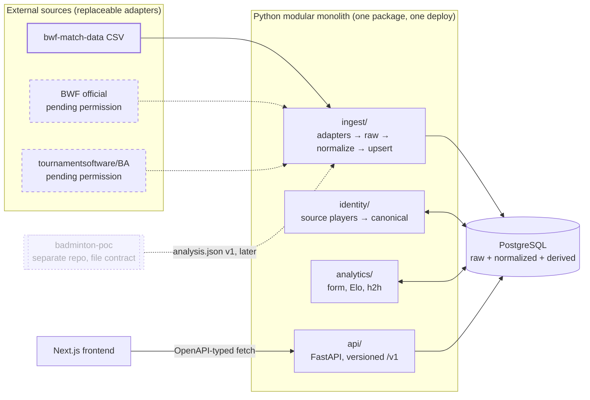
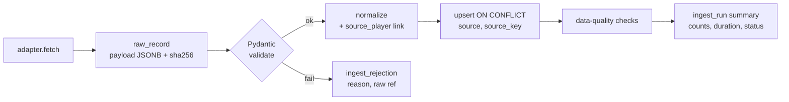
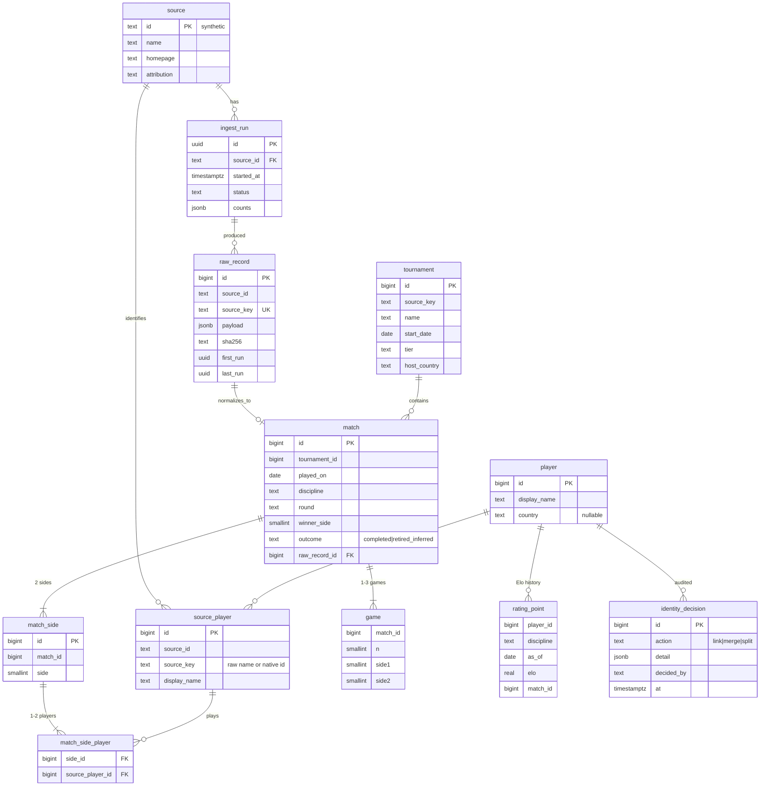

# Badminton Scout: Phase 0 Engineering Kickoff Report

Date: 2026-11-12 · Status: **approved with corrections** · Author: Claude (Opus 5.5) with Leo Xu

> **Revision 2026-11-12 (review corrections).** Where this report and an ADR disagree, the ADR wins.
> - Data rights now use a per-use, default-deny model. bwf-match-data has **no granted use**, so dev and CI use synthetic data only (ADR-0002, `data-sources.md`).
> - The identity schema is fully specified (ADR-0003).
> - Record keys no longer include scores; corrections become revisions (ADR-0005).
> - Elo evaluation uses chronological splits, real baselines, log loss, Brier score and calibration (ADR-0006).
> - The roadmap in §12 and §14 is restated: M0 is backend only, and the frontend moves to M3.

Labels used throughout:
**[Verified]** I checked it this session against source code, data or a live response.
**[Reported]** A third party states it; not independently checked.
**[Assumption]** A working assumption that has not been checked.
**[Rec]** My recommendation.

---

## 1. Executive Summary

1. **The main constraint is data rights, not engineering.** BWF data is publicly viewable and technically accessible. I found **no licence that permits redistributing it** in a public product. tournamentsoftware.com's robots.txt disallows `/player/`, `/profile/`, `/ranking/`, `/head-2-head` and `/match-info/` for every crawler **[Verified]**. Those are exactly the pages the MVP wants.
2. **A usable historical dataset exists**: `SahilMotyar/bwf-match-data`, with 105,147 BWF elite matches from 2007 to 2026 **[Verified]**. It has **no licence file**, and its README says the data is BWF's property **[Verified]**. Its quality is good enough for analysis, but **no use of it is granted** (ADR-0002). It stays out of git, CI and deployments, and development uses synthetic data.
3. **API Anything is real, well engineered and MIT-licensed. It does not support badminton today.** None of its 114 bundled sites is a badminton source **[Verified]**. It runs as a Node ≥ 22.13 server with a stdlib Python client **[Verified]**. It does not read robots.txt, and when blocked it escalates to a real browser **[Verified]**. **[Rec]** Keep it **out of the production data path**. Allow one time-boxed spike, only on a page where permission is confirmed.
4. **badminton-poc is a serious, honestly measured CV pipeline.** Milestone 1 passed on its development clips. Shot classification is **not usable yet** (0.59 accuracy across three recordings against a 0.75 target) **[Verified from its docs]**. It stays a separate system. Integration means a versioned `analysis.json` file contract, after the MVP.
5. **[Rec] Revised MVP:** "Player Intelligence, **singles first**". Search, profile, match history, rolling form, Elo trend, compare/head-to-head, and source attribution with freshness. Built and tested on **synthetic data** behind a default-deny rights gate (ADR-0002). Real data enters only once a source has evidence for the specific use, and a private invited deployment counts as redistribution. Permission requests (M1) run in parallel with the build.
6. **[Rec] Architecture:** a modular monolith. One Python package (FastAPI + SQLAlchemy + Alembic) holds the API, the ingestion CLI and the analytics. Postgres stores everything, with `pg_trgm` for name search. A Next.js frontend consumes TypeScript types generated from the OpenAPI spec. No queues, no microservices, no search cluster.
7. **First task (M0):** an independent git repository, a backend skeleton, Postgres with migrations, `/health` and `/ready`, tests and CI. The first player vertical slice is M3, built on synthetic fixtures.

---

## 2. Research Findings and Technical Feasibility

### 2.1 Current working directory **[Verified]**

- `/Users/leo/badminton-scout` was empty.
- `git rev-parse --show-toplevel` returns `/Users/leo`. A git repository at your home directory is tracking (or showing as untracked) everything you own, including `.ssh/`, `.zsh_history` and `.claude.json`. **Risk:** a stray `git add -A` from a subdirectory could commit secrets. **[Rec]** Run `git init` in `badminton-scout` now. Separately, decide whether the home-directory repository is intentional.
- `gh` is not installed, so I used shallow `git clone` into a scratch directory for read-only inspection. badminton-poc was **not** modified.

### 2.2 API Anything (goodnight000/api-anything @ `985ae8f`, 2026-11-07, v0.4.0)

| Question | Finding | Evidence |
|---|---|---|
| Licence | MIT | `LICENSE` **[Verified]** |
| What it is | Learns the HTTP request a page sends and replays it as a typed operation, with tiers: 1 = plain HTTP, higher = headless/real browser | README, `docs/DESIGN.md` **[Verified]** |
| Badminton coverage | **None.** `grep -ri "badminton\|tournamentsoftware\|bwfbadminton"` returns no matches. Its only sports site, `flashscore`, is football-only and marked "do not establish sports truth" | `sites/`, `sites/flashscore.md` **[Verified]** |
| Python integration | `pip install "git+…#subdirectory=python"`, not on PyPI, stdlib-only, Python ≥ 3.9. Every call goes through `api-anything serve` (Node ≥ 22.13). Typed result classes `ok/auth/rate/drift/blocked/…` | `docs/PYTHON.md` **[Verified]** |
| Learning | `learn_site` learns from one page load per value via a URL template. Pages that need clicks need `capture --steps`. Reads only | `docs/REFERENCE.md` §Status and known limits **[Verified]** |
| Respects robots.txt? | **No code path reads robots.txt** (no matches in `src/`). It backs off on 429/Retry-After | `grep` in `src/`, REFERENCE.md:697 **[Verified]** |
| Escalation | When blocked, it climbs to browser tiers. It does not solve CAPTCHAs | DESIGN.md:691 **[Verified]** |
| Data sharing | With sharing on, operations learned from public pages are uploaded to a public catalog. `--local-only` disables this | README §What leaves your machine **[Verified]** |
| Self-description | "Read each site's terms: you're responsible for how you use it." "Individual real sites vary and are not continuously verified." | README, REFERENCE.md **[Verified]** |

**Feasibility verdict:** technically it *can* wrap a permitted public results page. It would add a Node runtime to the backend's deployment, behaviour that may escalate to a browser, and a catalog that is "young" by its own description. For a product whose selling point is *trustworthy* data, that is the wrong dependency for the core path. **[Rec]** Use it only as a discovery tool in a spike: to find which JSON endpoint a permitted page uses. Then, if the use is permitted, write a small first-party `httpx` adapter with recorded fixtures.

### 2.3 badminton-poc (Kirion2k/badminton-poc @ `4e5b7e2`, 2026-10-29)

**[Verified from code and docs]**
- Python ≥ 3.11 CLI `badminton-poc run --video … --config …`. Stages: `preprocess → players (YOLO11-pose + ByteTrack) → shuttle (BadmintonTrackNet/TrackNetV3+InpaintNet via subprocess) → flight → analyze → render`. The stages communicate **only through files on disk**, which is a natural integration seam.
- Output `analysis.json` has keys `metadata, config, summary, rallies, events, hit_consolidation, offcourt_events_dropped`. Events carry `source` provenance such as `tracknet` or `shuttle_absence`. There is **no `schema_version` field** yet.
- Measured Milestone 1 results (dev clip `test-video2`): two-player coverage 92.9%, hitter assignment 92.5%, rally boundaries 6/6, hit P/R 0.82/0.95. Pooled over 3 labelled clips: contact F1 0.896.
- Shot classification (Milestone 2, BST-0 checkpoint): **0.5895 accuracy, 0.5395 macro-F1 across three recordings** against a 0.75 target. In its own docs' words: "A two-recording result was not predictive of a third."
- Scope: fixed camera, singles, elevated baseline view, 1–5 min clips. No doubles.
- **No LICENSE file.** If Badminton Scout ever vendors or redistributes it, you (as its owner) need to add one.

**Implication:** the defensible future claims are rally timelines, rally length, hit counts per player and hitter assignment on clean footage. Shot types, tactics and weaknesses are **not** defensible claims today.

### 2.4 Historical data sources

| Source | Coverage | Accuracy / schema | Identity | Licence / rights | Integration | Verdict |
|---|---|---|---|---|---|---|
| **bwf-match-data** (CSV, 2026-07-14) | 105,147 matches, 608 elite tournaments, 2007-01-16 → 2026-07-05; `index.json` has 4,029 tournaments **[Verified]** | 0 unparseable scores. 111 rows where `winner` disagrees with the game count (retirements, which the README says are not annotated). 208 rows with a blank round, which collide on a natural key. 2020–21 sparse (COVID) **[Verified, profile script]** | **Display names only**, no player IDs, and match IDs were dropped. 9,251 distinct name strings. 24 carry `[id]` suffixes. 31 pairs share the same name words in a different order or case, some genuinely the same person (`KIM Yong Hyun` / `Yong Hyun KIM`) and at least one likely two different people (`Yu Chen CHANG` / `Yu-Chang CHEN`) **[Verified]** | No licence file. README: "property of the Badminton World Federation… research/hobby redistribution" **[Verified]** | Trivial (CSV) | **No granted use** (ADR-0002). Not in git, CI or any deployment |
| **bwfbadminton.com** | Official results and rankings | Authoritative | Has numeric player and tournament IDs (visible in `index.json` URLs) **[Verified]** | robots.txt permissive (only `/24-live-blog/` disallowed) **[Verified]**. T&Cs returned **HTTP 403** to my fetch, so they are **unread**. BWF has exclusive data/streaming deals with Stats Perform (for betting) and built a data hub with PASS Consulting **[Reported]** | Unknown; no documented public API **[Reported]** | Request permission. Do not scrape |
| **tournamentsoftware.com / ba.tournamentsoftware.com** (Visual Reality B.V.) | Club, state, national and university tournaments, the only source for amateur and university play | Authoritative per tournament | Player profile IDs | robots.txt **disallows `/player/`, `/profile/`, `/ranking/`, `/head-2-head`, `/match-info/` for `*`** **[Verified]**. Terms are behind a cookie wall, **unread**. Personal data of amateurs (including minors) is involved, which raises privacy-law concerns **[Assumption]** | Unknown | **Do not automate.** Ask helpdesk@tournamentsoftware.com and Badminton Australia for a data agreement |
| **ShuttleSet** (CoachAI, KDD 2023) | 44 matches, 36,492 annotated strokes, 2018–21 singles **[Verified, local copy]** | Human-annotated, high quality | Player names only | Repo licence MIT. Annotations derived from broadcast video **[Verified]** | Easy | **Not for the MVP.** Useful later for CV validation and tactical research |
| Commercial feeds (Stats Perform, Sportradar for Badminton Europe, Datasports Group) | Live and historical | Commercial grade | IDs provided | Paid licence **[Reported]** | API | The legitimate route to public launch if BWF says no |
| Unofficial scraped APIs (e.g. parse.bot listing) | n/a | n/a | n/a | No rights conveyed | n/a | **Reject** |

**Public vs accessible vs permitted:** everything above is publicly *viewable*. bwf-match-data and the BWF pages are technically *accessible*. **Nothing is confirmed as *permitted* for a public product.** That is the main unresolved question of the project (§13).

### 2.5 Proposed stack: status

The current versions and features of Next.js, shadcn/ui, FastAPI, SQLAlchemy 2.x, Alembic and Postgres were **not re-verified this session [Assumption]**. They are mainstream, long-lived choices with no known blockers. Versions get pinned and verified at scaffold time (M0).

---

## 3. Product Requirements and MVP

**Vision:** the most *trustworthy* place to understand a badminton player's competitive record, where every number links to its source and its age.

**Target users (in order):**
1. Competitive amateur and university players scouting an upcoming opponent.
2. Coaches preparing players for tournaments.
3. Enthusiasts and fans of the elite game.

The elite data comes first because it is the only dataset available. The amateur and university segment, the long-term differentiator, depends on the tournamentsoftware/BA permission.

**Core use cases (MVP):**
- UC1 Find a player by partial or misspelled name.
- UC2 See their record: matches, results, scores, tournaments, with filters (discipline, year, tier).
- UC3 See form: rolling win rate and Elo trend over time.
- UC4 Compare two players: head-to-head, common opponents, side-by-side stats.
- UC5 Know where each fact came from and how fresh it is.

**[Rec] Scope challenge:**
- **Singles first** for ratings and comparison. Ingest all five disciplines, but Elo, compare and head-to-head ship for MS/WS only (49,642 matches). Doubles ratings need a decision about pair vs individual ratings, and that is a research question.
- **Elo is in the MVP.** "Performance trends" without a rating is just win rate, and Elo is cheap: a pure function over chronologically ordered matches.
- **Not in the MVP:** predictions (need chronological backtesting first), rankings (no licensed source), draws, CV, accounts.

**Non-goals (MVP):** user accounts, live scores, betting-adjacent features, scraping, doubles ratings, rankings, match predictions shown to users, mobile apps, CV upload.

**Future roadmap:**
- **R1** (after rights): public launch, monthly refresh.
- **R2:** doubles pair ratings, tournament pages and draws.
- **R3:** prediction model with chronological backtest, shown with calibration.
- **R4:** amateur and university data (if Visual Reality/BA agree).
- **R5:** CV upload via the badminton-poc contract, showing only validated metrics.

**Success criteria (MVP, private):**
- p95 search-to-profile < 1 s on the full dataset.
- 100% of displayed matches link back to a source record.
- The data-quality report shows zero unexplained duplicates.
- Elo backtest log-loss beats "higher-rated always wins at 50/50" on a held-out chronological split.
- 5 real players or coaches use it to scout a real opponent, and say it beat their current method.

---

## 4. Architecture Recommendation



**Component responsibilities**

| Module | Owns | Must not |
|---|---|---|
| `ingest/adapters/<source>.py` | Fetching or reading one source, emitting `RawRecord(source, source_key, payload, fetched_at)` | Touch normalized tables |
| `ingest/normalize.py` | Pydantic validation of raw → domain records, rejection with reasons | Do network I/O |
| `ingest/load.py` | Idempotent upsert, ingest-run bookkeeping | Contain business rules |
| `identity/` | Linking source players to canonical players, alias review, merge/split audit | Auto-merge on fuzzy match |
| `analytics/` | Pure functions: Elo, form, h2h. Persists derived tables | Know about HTTP or sources |
| `api/` | Read-only HTTP, pagination, response contracts | Call external sources |
| `web/` (Next.js) | Presentation | Know about any source system |

The system keeps running when every source is down, because the API only ever reads Postgres.

---

## 5. Technology Decisions and Trade-offs

| Area | Choice | Alternatives considered | Why |
|---|---|---|---|
| Shape | **Modular monolith**, one Python package and one deploy, plus the frontend | Separate ingestion service, microservices | One developer. Ingestion is a batch CLI that runs monthly, not a service |
| Backend | **FastAPI + Pydantic v2 + SQLAlchemy 2 + Alembic** | Django, Litestar | Your preference. Typed contracts, OpenAPI for free. Django's admin is tempting for alias review, but a CLI review tool is enough for now |
| Python tooling | **uv, ruff, pyright, pytest** | poetry, mypy | Fast and standard. Same as badminton-poc (`uv`) |
| DB | **PostgreSQL 16+**, `pg_trgm` for fuzzy names, `unaccent` | Elasticsearch/Meilisearch | ~10k players. Trigram search in Postgres is enough, with no second datastore |
| Jobs | **CLI commands** (`scout ingest bwf-csv`, `scout ratings rebuild`), run by hand or a cron in CI | Celery, Redis, Airflow, Dagster | Monthly batch over ~100k rows takes seconds. No queue needed |
| Frontend | **Next.js (App Router) + TS + Tailwind + shadcn/ui** | FastAPI + Jinja/HTMX | Your preference and good for SEO later. Server components fetch from the API at request time |
| Charts | **Recharts** (via shadcn chart components) | Visx, ECharts | Matches shadcn, enough for line and bar charts |
| API contract | **openapi-typescript**, types generated from FastAPI's `/openapi.json`, checked in CI | Hand-written types, tRPC | One source of truth across languages |
| Frontend tests | **Vitest + Testing Library, Playwright** | Jest, Cypress | Standard |
| Hosting | Frontend on **Vercel**. API on **Render or Fly.io**. DB on **Neon** | Single VPS | Managed, cheap at this size. Exact pricing and plan limits **unverified** and decided at M8 |
| Data acquisition | **First-party adapters** (CSV now, `httpx` later where permitted) | API Anything in production | §2.2: Node runtime, browser escalation, no robots.txt handling, young catalog |

Rejected outright for now: Kubernetes, Kafka, GraphQL, a separate search engine, a feature store, any LLM in the data path.

---

## 6. Data Acquisition and API Anything Strategy

**Ingestion pipeline (every adapter follows it)**



**Adapter interface**

```python
class SourceAdapter(Protocol):
    source: SourceId                      # e.g. "bwf_match_data"
    def fetch(self) -> Iterable[RawRecord]: ...    # the only I/O
    def parse(self, raw: RawRecord) -> ParsedMatch | Rejection: ...  # pure, fixture-tested
```

**Rights gate (superseded, see ADR-0002):** each source has a per-use grant set in reviewed code (`scout.sources`). Unknown sources and ungranted uses are denied. Configuration can only restrict, and production additionally requires `HOSTED` + `REDISTRIBUTE`. The adapter's `licence` attribute above is replaced by a lookup into that registry.

**Idempotency and corrections (superseded, see ADR-0005):** the record key is a locator built from fields that identify the fixture and never get corrected, never from the score. A changed payload becomes a new `raw_record_revision`. Locator collisions within a run become `ingest_issue`s rather than guesses. A re-run of the same file writes no revisions.

**API Anything plan (spike S1, time-boxed to 1 day, after M2):**
1. Precondition: written permission or confirmed T&Cs for one specific BWF results page. Without it, the spike is **not run**.
2. `api-anything setup --local-only` in an isolated `API_ANYTHING_HOME`, calls at `maxTier: 1`, and no login. One tournament results page.
3. Output: a short report in `docs/spikes/` covering whether it found a structured endpoint, how stable it looked, and whether a 40-line `httpx` adapter would do the same.
4. Decision recorded as an ADR. Default expectation: a first-party adapter, with API Anything kept as a dev-time discovery tool.

---

## 7. Database and Identity Model

> The diagram below is the original sketch. The authoritative definitions are ADR-0003 (`source_player`, `player`, `player_link`, `identity_candidate`, `identity_decision`) and ADR-0005 (`raw_record`, `raw_record_revision`, `ingest_issue`, `match.raw_record_id` unique). The `source` table holds descriptive metadata only; rights live in code. M0 implements `source`, `ingest_run`, `raw_record` and `raw_record_revision`.



**Identity rules [Rec, ADR-0003]:**
- Every source-specific identity is a `source_player`. A canonical `player` is linked to one or more source players.
- **Automatic linking only on exact identity:** the same native ID, or the same exact name string within the same source.
- Candidate merges (case-only differences, swapped name order, `[id]`-suffixed duplicates) go into a review queue, `scout identity candidates`. A human approves each one, and an `identity_decision` row is written. **No automatic fuzzy merges**: profiling showed a token-equal pair that is likely two people.
- Matches always reference `source_player`, so a wrong merge is undone by re-linking, with no rewrite of match data.

**Provenance:** every displayed match carries `source.attribution`, `raw_record.source_key` and `ingest_run.started_at`, which drives the "as of" label.

---

## 8. Frontend UX Architecture

Reference products: BadmintonRanks and similar ranking sites, plus general sports analytics UIs. I did **not** review them in a browser this session, so the patterns below are general sports analytics practice, not observations of those sites **[Assumption]**. A competitive UX review is backlog item M7-1.

**Information architecture**

```
/                         search-first home: one search box, recently viewed, data freshness banner
/players?q=               results: name, country, discipline, last played, match count
/players/[id]             profile
   ├ header               name, country, disciplines, record W-L, current Elo, "data as of"
   ├ Form                 Elo line chart + rolling-20 win rate; tier/discipline filters
   ├ Matches              table: date, tournament, round, opponent (link), score, W/L, source ⓘ
   └ Opponents            most-played, best and worst records
/compare?a=&b=            head-to-head list, side-by-side stats, common opponents, Elo overlay
/tournaments/[id]         (R2) results by round
/about/data               sources, licences, coverage, known gaps, refresh dates
```

**Design direction:**
- Neutral surfaces, one accent colour, tabular numerals, dense but readable tables. Charts only where change over time matters (Elo, form).
- Every page shows a freshness chip ("Data as of 2026-07-05 · bwf-match-data") linking to `/about/data`.
- Retirements inferred from scores show a "ret.?" marker with a tooltip, never a silent W/L.
- Required states: loading skeletons, empty ("no singles matches since 2007"), error (API down shows a cached-data notice), and the not-found player page.
- Accessibility: WCAG 2.2 AA contrast, full keyboard navigation for search and tables, chart data also available as a table.
- Fixtures for design work are synthetic players and matches, labelled "illustrative". Real records appear only from a source with the needed grant (ADR-0002).

---

## 9. AI-Assisted Development Workflow

**Agent use [Rec]: few, and only where the output can be checked independently.**

| Role | When used | Output checked by |
|---|---|---|
| Main session (me) | All planning, implementation and integration | You, plus CI |
| Explore subagent | Wide read-only searches (library docs, an unfamiliar codebase) | The main session reads cited files |
| Reviewer subagent (`/code-review`, `ponytail-review`) | Before every PR on non-trivial changes | You read the findings |
| Parallel implementers in **worktrees** | Only for genuinely independent work, e.g. frontend M3 against a frozen OpenAPI contract while the backend builds M5 | CI on each branch, with no overlapping files |

The Architect, Data Engineer and Frontend Engineer roles are **hats the main session wears**, not standing agents. A spawned agent starts cold and costs context. Splitting is justified only by parallelism with a fixed contract between the pieces.

**Per-feature loop:** spec section in this report (or `docs/specs/<feature>.md` when bigger than a paragraph) → plan → TDD for analytics and parsing → implement → `make check` → self-review of the diff → reviewer subagent → PR. Nothing is committed, pushed, merged or deployed without your approval.

---

## 10. Repository Structure and Engineering Standards

```
badminton-scout/
├── AGENTS.md              canonical agent/contributor instructions (short)
├── CLAUDE.md              imports AGENTS.md + Claude-only notes
├── Makefile               check, test, dev, db-up: one entry point for humans, agents and CI
├── compose.yaml           postgres only
├── backend/
│   ├── pyproject.toml     uv-managed
│   ├── src/scout/
│   │   ├── api/           FastAPI routers, response schemas
│   │   ├── ingest/        adapters/, normalize.py, load.py, quality.py
│   │   ├── identity/
│   │   ├── analytics/     elo.py, form.py, h2h.py (pure)
│   │   ├── db/            models.py, session.py
│   │   └── cli.py         `scout …`
│   ├── migrations/        alembic
│   └── tests/{unit,integration,contract,fixtures}/
├── web/                   Next.js app; src/lib/api.gen.ts generated, never hand-edited
├── docs/
│   ├── kickoff-report.md  this file (PRD, architecture, testing, backlog until they split)
│   ├── data-sources.md    living source & licence register
│   ├── adr/NNNN-*.md
│   └── specs/             per-feature specs when needed
└── .github/workflows/ci.yml
```

**Conventions:**
- Conventional Commits.
- Branches `feat/…`, `fix/…`, `spike/…` off `main`, squash-merged via PR.
- `main` is always deployable.
- Migrations are forward-only in production.
- Configuration comes from environment variables via `pydantic-settings`. `.env` is git-ignored and `.env.example` is committed.

---

## 11. Testing, CI/CD, and Deployment Strategy

| Layer | What | Tooling | Runs |
|---|---|---|---|
| Unit | Score parsing, retirement inference, Elo update, rolling form, name normalization, licence gate | pytest, plus Hypothesis for score-parser properties | every push |
| Integration | Ingest a fixture → Postgres → query; idempotent re-run is a no-op | pytest + Postgres service container | every push |
| Contract (internal) | `openapi.json` snapshot diff. `api.gen.ts` regenerated and unchanged | pytest + `openapi-typescript --check` | every push |
| Contract (external) | Adapter `parse()` against fixtures in `tests/fixtures/<source>/`: synthetic, or recorded payloads only from a source with a `STORE` grant | pytest | every push. Live re-record by hand only |
| Data quality | Duplicate source keys, winner/score disagreement counts, orphan players, impossible scores (> 30), date ranges, rows per source vs last run (±5% alarm) | `scout quality` returns non-zero on violation | after every ingest, and in CI on the fixture |
| Analytics regression | Golden Elo trajectories for 5 fixed players on the fixture | pytest snapshot | every push |
| Rating evaluation (M5) | ADR-0006: chronological splits, four baselines, log loss, Brier score, calibration, leakage tests | pytest | when M5 starts |
| E2E | Search → profile → compare on seeded DB | Playwright | every PR |
| Security | `pip-audit`, `npm audit --omit=dev`, gitleaks, Dependabot | GitHub Actions | every PR + weekly |

**CI (`.github/workflows/ci.yml`):** `backend` (ruff, pyright, pytest with Postgres service) ∥ `web` (eslint, tsc, vitest) → `e2e` (compose up, seed fixture, Playwright). **No live third-party requests in CI.**

**CD (M8):**
- Vercel preview per PR.
- API auto-deploys from `main` to staging.
- Production is a manual promotion, gated on the licence decision.
- Secrets live in GitHub Actions / Vercel / host secret stores, never in the repo.

---

## 12. Engineering Roadmap and GitHub Issue Backlog

> **Roadmap revised 2026-11-12 (M1B).** The owner obtained BWF and Tournament Software authorisations (ADR-0008), and real provider data now drives the plan. M0 and M1A are done. The earlier table is replaced by:

| # | Milestone | Status |
|---|---|---|
| M0 | Engineering foundation | Done |
| M1A | API Anything provider, rights gate, live smoke test | Done |
| **M1B** | BWF and Tournament Software operation discovery and validation | Tournament Software `ba.` working. `www.` / `bwf.` / BWF blocked on access methods (`docs/badminton-providers.md`) |
| M2 | Real match ingestion, discovery, minors guard, identity review, player API | **In progress**: discovery, controlled import, ADR-0009 guard, identity review and player API done. `www.` consent and BWF open |
| M3 | Player search, profiles, matches, tournament explorer (frontend) | |
| M4 | Identity linking (ADR-0003 candidates and review) and historical performance analytics | |
| M5 | Elo (ADR-0006) and head-to-head comparisons | |
| M6 | Scouting reports | |
| M7 | Video integration (ADR-0004) | |

**Smallest first vertical slice (M3):** synthetic singles fixture → `scout ingest` → `/v1/players?q=` + `/v1/players/{id}/matches` → two Next.js pages → one Playwright test. Each match row shows its source and ingest date.

---

## 13. Major Risks and Unresolved Questions

| Risk / question | Impact | Mitigation | Owner |
|---|---|---|---|
| **No right to publicly redistribute BWF results** | Blocks public launch | Licence gate in code. M1 permission requests. Commercial feed as fallback | Leo |
| tournamentsoftware disallows player, profile and H2H paths | Amateur/university vision blocked | Formal data agreement, or partner with clubs/unis who export their own results | Leo |
| BWF and tournamentsoftware T&Cs **unread** (403 / cookie wall) | Unknown restrictions | Read them by hand in a browser and paste the relevant clauses into `data-sources.md` | Leo |
| Amateur data = personal data, possibly of minors | Privacy-law exposure | Do not ingest amateur data without an agreement and a privacy review | Leo |
| Name-only identity in bwf-match-data | Wrong player stats | Human-reviewed merges, reversible links | Eng |
| bwf-match-data is a one-person repo, last updated 2026-07-14 | Goes stale or disappears | Vendor a pinned copy with its sha256 in the source register. Freshness chip shows its age | Eng |
| Retirements not annotated | W/L shown with false certainty | Infer `retired_inferred` from the score and flag it in the UI | Eng |
| Overstating CV ability | Credibility | Only show metrics with a measured accuracy above threshold, printed with their uncertainty | Eng |
| Home directory is a git repo | Secret leakage | `git init` here. Review `/Users/leo/.git` | Leo |

**Questions for you:**
1. ~~Private MVP while rights are pending?~~ Resolved: no. A private deployment counts as `HOSTED` + `REDISTRIBUTE` (ADR-0002).
2. Are you OK with me drafting the per-use permission-request emails (M1)? You would send them.
3. Is `/Users/leo/.git` intentional? (badminton-scout now has its own repository. The parent was not modified.)

---

## 14. Recommended First Implementation Task

**M0 only** (see §12): independent repository, backend skeleton, Postgres and migrations, `/health` and `/ready`, rights gate, tests, CI. No frontend, no real data. The next task after M0 is M2's synthetic data generator and revisioned ingest. The Next.js skeleton is M3, built against the real `players` contract.
